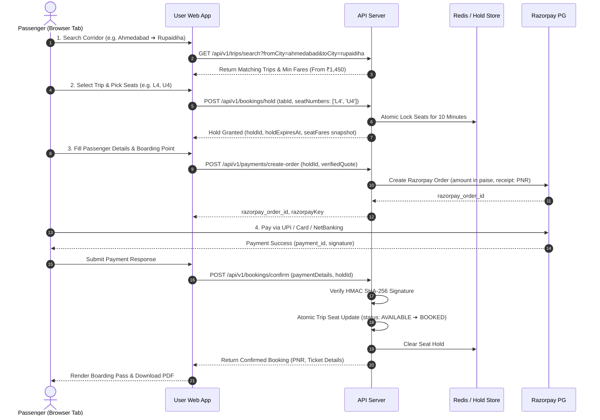
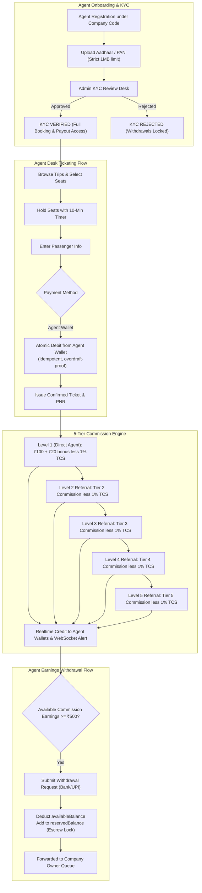
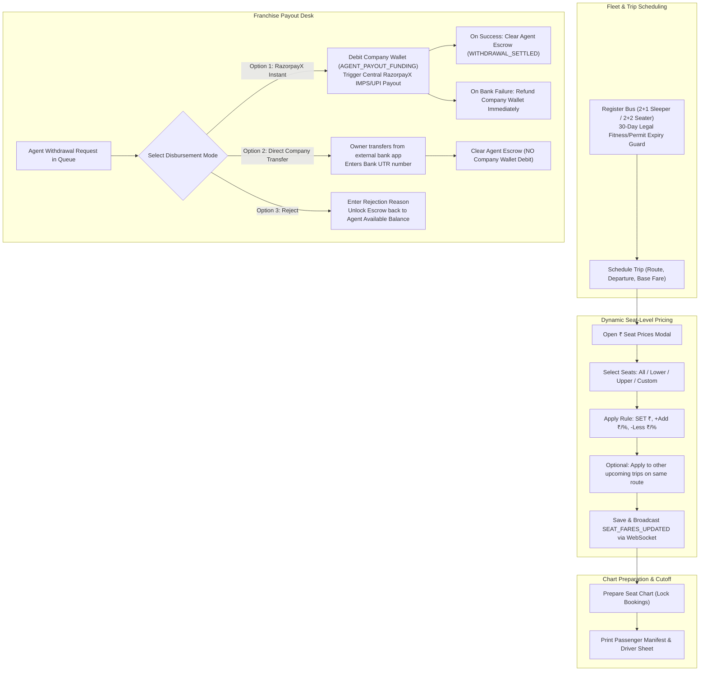
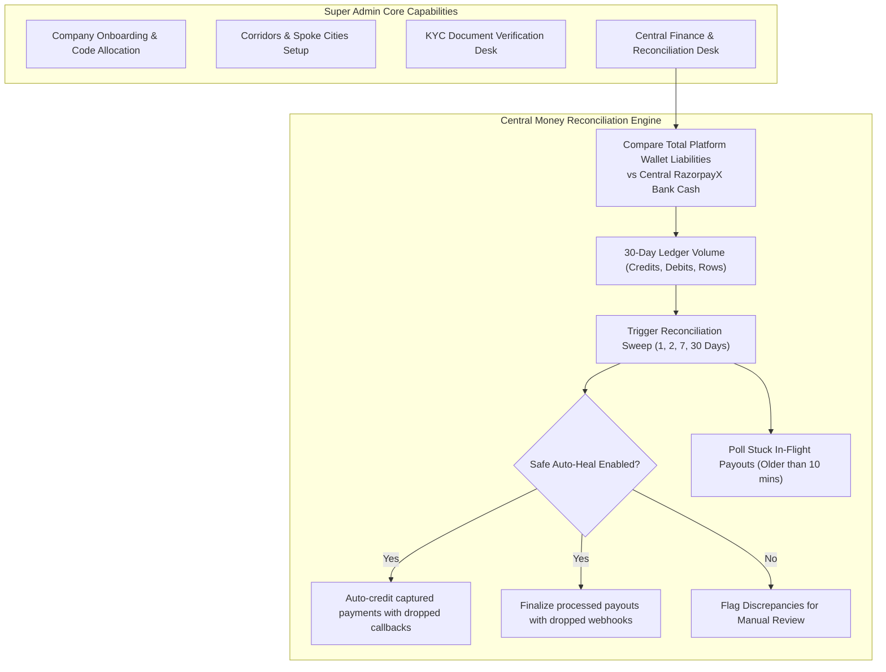
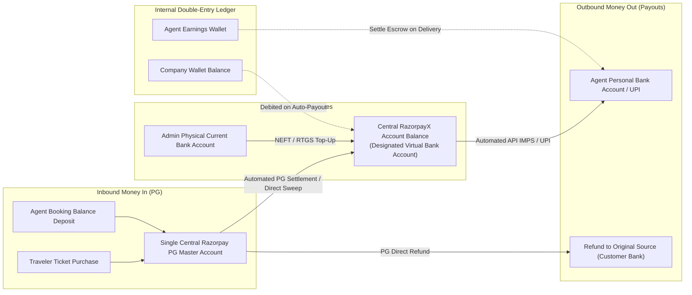
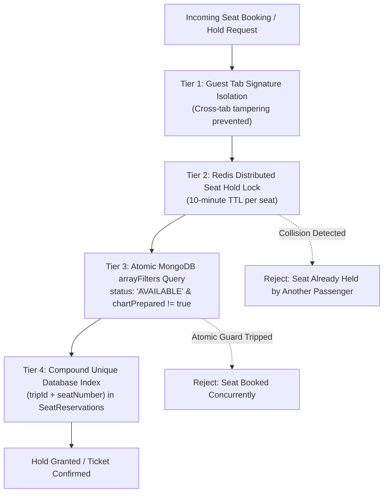

# Rupadiya Intercity Bus Booking Platform
## Comprehensive System Architecture & Operational Flow Guide
*Covering User Web, Agent Portal, Company Portal, Super Admin Portal, RazorpayX Financial Flow, and Core Concurrency Engine*

---

## 1. Executive Summary & Platform Overview

The **Rupadiya Platform** is a specialized, multi-tenant intercity mobility and bus franchise ticketing system. It bridges cross-border and long-distance passenger travel connecting the strategic hub of **Rupaidiha (India–Nepal Border)** with key economic and industrial corridors across **Gujarat, Maharashtra, Saurashtra, and South India**.

The platform is designed around 4 dedicated user portals powered by a unified high-performance API backend:

| Portal | Audience / Role | Primary Capabilities |
| :--- | :--- | :--- |
| **User Website (`apps/user-web`)** | Travelers, Commuters, General Public | Zero-friction search, Rupaidiha corridor enforcement, live 2+1/2+2 seat maps, 10-minute seat hold lock, Razorpay PG checkout, live PNR tracking, and ISO-32000 PDF boarding pass downloads. |
| **Agent Portal (`apps/agent-portal`)** | Franchise Booking Counter Agents | Agent desk quick-booking, Agent Wallet 1-click debits, 5-level referral commission engine (with 1% TCS withholding), KYC verification, deposit requests, and earnings withdrawals. |
| **Company Portal (`apps/company-portal`)** | Bus Operators & Fleet Owners | Fleet and coach layout designer, daily trip scheduling, dynamic per-seat pricing (Upper vs Lower decks, selective discounts), seat chart locking, driver manifests, and dual-mode agent payout approvals. |
| **Admin Portal (`apps/admin-portal`)** | Platform Super Administrators | Multi-tenant company onboarding, corridor routes, agent KYC approval desk, Central Finance & Reconciliation desk, RazorpayX bank liability parity, and safe auto-heal engine. |

```
                                 ┌──────────────────────────────────────────────────────────┐
                                 │                 CENTRAL BACKEND ENGINE                   │
                                 │          Node.js · Express · MongoDB · Redis             │
                                 └────────┬───────────────┬────────────────┬───────────────┬┘
                                          │               │                │               │
                    ┌─────────────────────┴───────┐       │                │               └─────────────────────────┐
                    ▼                             ▼       ▼                ▼                                         ▼
         ┌─────────────────────┐        ┌───────────────────┐    ┌───────────────────┐                     ┌───────────────────┐
         │     USER WEBSITE    │        │   AGENT PORTAL    │    │  COMPANY PORTAL   │                     │   ADMIN PORTAL    │
         │  Traveler Ticketing │        │ Franchise Booking │    │  Operator Fleet   │                     │ Platform Admin    │
         │  Port 3000          │        │ Port 3001         │    │  Port 3002        │                     │ Port 3003         │
         └─────────────────────┘        └───────────────────┘    └───────────────────┘                     └───────────────────┘
```

---

## 2. Platform Corridor: The Rupaidiha Hub-and-Spoke Invariant

To eliminate operational chaos and preserve route integrity, the platform enforces a **Hub-and-Spoke Topological Invariant**:
- **Hub**: Rupaidiha (`RUPAIDIHA` / `RUPADIYA`).
- **Spokes**: Ahmedabad, Surat, Baroda, Rajkot, Jamnagar, Mumbai, Pune, Nashik, Goa, Bangalore, Hyderabad, etc.
- **Rule**: Every single commercial trip must either **originate from Rupaidiha** or **terminate in Rupaidiha**. Point-to-point travel between two spokes (e.g., Surat to Mumbai) without passing through the hub is prevented at both database and routing layers.

```
       [ Ahmedabad ] <───────────────────┐
       [ Surat     ] <─────────────┐     │
       [ Rajkot    ] <───────┐     │     │
                             ▼     ▼     ▼
                        [ RUPAIDIHA HUB ] (Nepal Border)
                             ▲     ▲     ▲
       [ Mumbai    ] <───────┘     │     │
       [ Pune      ] <─────────────┘     │
       [ Bangalore ] <───────────────────┘
```

---

## 3. Flow 1: User Website (`apps/user-web`) – Traveler Booking Flow

The traveler journey is designed for speed, clarity, and zero drop-off, requiring no mandatory upfront account creation.



### Detailed Step-by-Step Logic:

### 3.1 Corridor Search & Dynamic "From ₹X" Pricing
1. Traveler selects origin and destination. The UI automatically maintains the Rupaidiha hub invariant: swapping cities keeps Rupaidiha locked on one side.
2. The search API calculates `minFare` across all available seats in each scheduled bus, ensuring travelers see real-time price cues (e.g. "From ₹1,450").

### 3.2 Seat Map Selection & Concurrency Hold Locking
1. Displays 2+1 Sleeper (Lower/Upper Berths) or 2+2 Seater layout.
2. **Ladies-Seat Rule**: If a female passenger has booked an adjacent seat, male passengers cannot select the neighbor seat; female passengers can select any seat.
3. **10-Minute Countdown Hold**:
   - When a passenger selects seats and advances, the server creates an atomic hold in Redis (with an in-memory fallback store).
   - WebSocket broadcasts `SEATS_HELD` to all other active browsers in the `trip:<tripId>` room.
   - Other users immediately see those seats colored Amber (`HELD`) with a countdown, preventing conflicting double-booking attempts.
   - **Tab Isolation**: Every browser tab receives a cryptographic guest signature (`tabGuestMiddleware`). Holds are isolated per tab, preventing one tab from overwriting another.

### 3.3 Dynamic Quote & Price Lock Invariant
- Fares are calculated on an **individual per-seat basis**:
  $$\text{Subtotal} = \sum \text{seat.fare}$$
- When a hold is created, the server captures a `seatFares` snapshot. Even if the bus operator adjusts prices while the customer is filling in passenger names, the customer's price remains locked during the 10-minute hold window.
- Taxes and extras:
  $$\text{Total Payable} = \text{Subtotal} + 5\% \text{ GST} + \text{Insurance (₹5/passenger)} - \text{Discount}$$

### 3.4 Razorpay PG Checkout & Atomic Confirmation
1. Customer initiates payment. The backend verifies the hold has not expired and creates a Razorpay PG Order.
2. On payment completion, the backend validates the Razorpay HMAC SHA-256 signature against `RAZORPAY_KEY_SECRET`.
3. An atomic MongoDB `findOneAndUpdate` transitions the seats from `AVAILABLE` to `BOOKED` using `arrayFilters`.
4. If a race condition or payment delay occurs and the seats were taken, the payment engine triggers an automatic refund rather than issuing a duplicated ticket.
5. The confirmed ticket is displayed with options to print or download an ISO 32000-1 / PDF 1.4 document.

---

## 4. Flow 2: Agent Portal (`apps/agent-portal`) – Franchise Booking Desk

Franchise booking agents are local ticketing counters authorized to book seats for walk-in passengers, earn commissions, and withdraw profits.



### Key Agent Portal Features:
1. **Instant Wallet Booking**: Agents do not need to enter credit cards or OTPs for each ticket. They maintain a pre-funded booking wallet. Clicking "Book with Wallet" deducts the exact quote instantly.
2. **5-Level Referral Tree & 1% TCS Withholding**:
   - Every booking distributes multi-tier commissions up to 5 levels of the referral hierarchy.
   - Section 194O compliance: exactly 1% TCS is withheld automatically and logged in the tax ledger for government filing.
3. **Strict Earning Source Protection**:
   - Agents can deposit funds into their wallet solely to issue tickets.
   - **Withdrawals can only be made from accredited earnings (commissions)**, preventing money-laundering or unauthorized capital extraction.
4. **Escrow Lock**:
   - When an agent requests a withdrawal (minimum ₹500), the funds move immediately to `reservedBalance`.
   - The agent cannot double-spend this balance while waiting for company approval.

---

## 5. Flow 3: Company Portal (`apps/company-portal`) – Bus Operator Desk

Bus operators manage the physical buses, schedule daily departures, configure dynamic per-seat pricing, prepare final passenger charts, and disburse agent payouts.



### 5.1 Dynamic Seat-Level Pricing
- **Why It Exists**: To maximize bus load factors. Upper sleeper berths or back seats often sell slower, while lower front berths are in high demand.
- **Capabilities**:
  - Operators can select individual seats, or use quick selectors (**All Lower**, **All Upper**, **All**).
  - Adjust prices via:
    - `SET`: Fixed rupee amount (e.g. Lower ₹1,650, Upper ₹1,450).
    - `INCREASE` / `DECREASE`: Modify by fixed amount (₹) or percentage (%).
  - **Invariants**:
    - `BOOKED` seats are permanently locked and cannot be repriced.
    - Fares are clamped between ₹1 and $5 \times \text{baseFare}$.
    - Pricing changes can be duplicated across up to 60 sibling trips scheduled on the same bus and route.
    - Emits real-time WebSocket event `SEAT_FARES_UPDATED`, immediately refreshing prices on user and agent screens.

### 5.2 Agent Withdrawal Settlement (Maker-Checker Workflow)
Operators review requests submitted by their franchise agents:
- **Option 1 (Automated RazorpayX Payout)**:
  - System debits the Company's platform wallet (`AGENT_PAYOUT_FUNDING`).
  - Central RazorpayX executes instant IMPS/UPI transfer to the agent's bank account.
  - If the bank rejects the payout, the company wallet is refunded immediately (`AGENT_PAYOUT_FUNDING_REVERSAL`).
- **Option 2 (Direct Company Bank Transfer - Manual UTR)**:
  - Operator pays the agent directly from their external bank/UPI app.
  - Operator inputs the 12-digit Bank UTR reference.
  - **The Company's platform wallet is NOT debited** (preventing double-charging).
  - Agent's escrow is cleared, and the transaction is settled.
- **Option 3 (Reject)**:
  - The held funds are returned to the agent's available wallet balance.

---

## 6. Flow 4: Admin Portal (`apps/admin-portal`) – Central Platform Super Admin

The Super Admin maintains the central payment gateway, manages companies and corridors, verifies KYC, and audits platform finances.



### 6.1 Central Money Reconciliation & Auto-Heal
Since Razorpay cannot mirror internal multi-tenant digital wallets, the platform enforces strict 1:1 parity between internal ledgers and central banking balances:
1. **Total Liabilities**: Sum of all Agent Wallets (available + reserved) and Company Wallets.
2. **Cash Pool**: Central RazorpayX bank account balance.
3. **Safe Auto-Heal**:
   - If a customer was charged on Razorpay PG but the server callback dropped, Auto-Heal detects the captured order, credits the wallet/ticket, and logs an immutable ledger entry.
   - If an automated payout was processed by the bank but the webhook was missed, the sweeper polls RazorpayX, marks the request `APPROVED`, and clears agent escrow.

---

## 7. Banking & Razorpay Master Account Architecture



### Wallet & Ledger Balance Invariants (Mathematical Proof):

| Action | Agent Available | Agent Reserved | Company Wallet | Platform Central Bank Cash | Net Platform Liability Change |
| :--- | :---: | :---: | :---: | :---: | :---: |
| **Agent Requests ₹2,000** | −₹2,000 | +₹2,000 | ₹0 | ₹0 | ₹0 *(Internal escrow lock)* |
| **Company Approves via RazorpayX** | ₹0 | −₹2,000 | −₹2,000 | −₹2,000 | −₹2,000 *(Cash leaves bank; company wallet liability reduced)* |
| **Company Approves via Manual UTR** | ₹0 | −₹2,000 | ₹0 | ₹0 | −₹2,000 *(Agent liability settled directly by company external cash)* |
| **RazorpayX Payout Fails** | ₹0 | ₹0 | +₹2,000 *(Refund)* | ₹0 | +₹2,000 *(Company wallet restored; retry enabled)* |
| **Company Rejects Request** | +₹2,000 | −₹2,000 | ₹0 | ₹0 | ₹0 *(Escrow released back to agent)* |

---

## 8. Concurrency & Double-Booking Protection Engine

To guarantee zero double-booking under extreme high-concurrency conditions (e.g. festival rush ticketing), the platform implements a **4-Tier Concurrency Shield**:



1. **Tier 1 (Tab Signature Isolation)**: Each browser tab carries a cryptographically signed tab token. Users opening multiple tabs cannot hijack holds across tabs.
2. **Tier 2 (Redis Distributed TTL Lock)**: A 10-minute lock key `trip:<tripId>:seat:<seatNumber>` prevents concurrent holds across different browser sessions.
3. **Tier 3 (Atomic `arrayFilters` Guard)**: Ticket confirmation updates seats using an atomic condition:
   ```javascript
   Trip.updateOne(
     { _id: tripId, status: { $in: ['SCHEDULED', 'BOARDING'] } },
     { $set: { "seats.$[s].status": "BOOKED", "seats.$[s].passenger": paxInfo } },
     { arrayFilters: [{ "s.seatNumber": { $in: requestedSeats }, "s.status": "AVAILABLE" }] }
   );
   ```
4. **Tier 4 (Compound Unique Indexes)**: `SeatReservation` maintains a unique index on `{ tripId: 1, seatNumber: 1 }`, guaranteeing the database rejects any concurrent insert attempts.

---

## 9. Security, Anti-Scraping & Origin Guard

1. **Origin Guard Middleware**: Rejects automated bot queries or requests from unauthorized origins. Public access is restricted strictly to search and route lookup.
2. **Browser Session & CSRF Cookie Protection**: Unauthenticated travelers receive an `httpOnly`, `SameSite=Lax` signed browser session cookie, preventing token hijacking.
3. **Input Sanitization**: Deep sanitization strips `<script>` tags, XSS payloads, and NoSQL query injection operators (`$gt`, `$ne`, `$where`).
4. **Rate Limiting**: Distributed sliding-window rate limiters prevent API abuse on hold and booking endpoints.

---

## 10. Summary Verification Matrix

| Component | Tested Feature | Status |
| :--- | :--- | :--- |
| **Backend API** | 48 Unit & Integration Tests (Referral engine, company isolation, seat pricing, holds, payouts) | **40 Pass, 0 Fail, 8 Skipped (Mock DB)** |
| **User Web** | Rupaidiha corridor, dynamic per-seat pricing labels, live Redis hold, PDF ticket downloads | **Production Build Verified** |
| **Agent Portal** | Wallet checkout, 5-level commission ledger, 1% TCS tax entries, KYC gate, earnings withdrawals | **Production Build Verified** |
| **Company Portal** | Fleet builder, dynamic per-seat pricing modal, sibling trip sync, dual-mode payout desk | **Production Build Verified** |
| **Admin Portal** | Multi-tenant company oversight, KYC review desk, finance reconciliation & safe auto-heal | **Production Build Verified** |
